# Rapport TP03 – Pipeline CI/CD pour une application Web PHP

**Module :** DevSecOps – SI5  
**Groupe :** Youssef Ben Mzoughia / Fares Kobbi / Hammoud Younes

---

## Partie 1 – Compréhension et configuration de base

### 1.1 Analyse du projet PHP

#### Vue d'ensemble

Le projet est une petite application Web PHP dont l'unique fonctionnalité est de **générer dynamiquement une image PNG** (600×200 px) contenant du texte. Les dépendances sont gérées avec **Composer**.

#### Arborescence


*Figure 1 – Arborescence du projet (`tree -L 2 -a -I '.git|vendor'`)*

| Élément | Rôle |
|---|---|
| `public/index.php` | Point d'entrée Web. Charge l'autoloader et le fichier `.env`, envoie l'en-tête `Content-type: image/png`, puis instancie `ImageCreator` et génère l'image. |
| `public/info.php` | Appelle `phpinfo()` (page de diagnostic de la configuration PHP). |
| `public/font/consolas.ttf` | Police TrueType utilisée pour écrire le texte dans l'image. |
| `src/ImageCreator.php` | Classe métier (espace de noms `App`) qui dessine l'image avec l'extension GD. |
| `tests/Unit`, `tests/Feature` | Tests PHPUnit (actuellement deux tests d'exemple `assertTrue(true)`). |
| `composer.json` / `composer.lock` | Dépendances et versions verrouillées. |
| `phpunit.xml` | Configuration des tests (suites `Unit` et `Feature`). |
| `phpcs.xml` | Règles de qualité de code : PSR-12 + PHPCompatibility. |
| `Docker/Dockerfile` | Image Docker de l'application (`php:8.2-apache`). |
| `.circleci/config.yml` | Définition du pipeline CI/CD. |
| `.env.example` | Modèle de fichier d'environnement (variable `APP_SECRET`). |

#### Fonctionnement du code

La classe `App\ImageCreator` :

1. crée une image vraie couleur 600×200 avec `imagecreatetruecolor` ;
2. alloue trois couleurs (blanc, couleur 1, couleur 2) via `imagecolorallocate` ;
3. construit un premier texte `"<texte> - <date et heure>"` grâce à la bibliothèque **Carbon** ;
4. construit un second texte, auquel est **ajoutée la valeur de `$_ENV['APP_SECRET']`** si elle est définie ;
5. dans `createImage()`, dessine deux rectangles imbriqués (`imagefilledrectangle`), écrit les textes avec `imagettftext`, puis envoie le PNG sur la sortie standard (`imagepng`).

`index.php` fixe les couleurs et les textes puis délègue tout à cette classe. La variable `APP_SECRET` est lue depuis l'environnement ou le fichier `.env` (via `vlucas/phpdotenv`) : c'est le **secret de démonstration** qui sera géré par Infisical dans la partie 2.3.

#### Dépendances (Composer)

- **Exécution :** PHP ≥ 8.2, extension `ext-gd`, `nesbot/carbon` 2.72.1 (gestion des dates), `vlucas/phpdotenv` 5.6.0 (chargement du `.env`).
- **Développement :** `phpunit/phpunit` 10.5.2 (tests) et `roave/security-advisories` (empêche l'installation de paquets ayant une faille de sécurité connue).
- L'autoloading est de type PSR-4 : `App\` → `src/` et `Tests\` → `tests/`.


### 1.2 Configuration de l'environnement Docker

#### Le Dockerfile (`Docker/Dockerfile`)

L'image est basée sur `php:8.2-apache` (PHP 8.2 conforme à `composer.json`, Apache comme serveur Web). Les principales étapes sont :

| Étape | Rôle |
|---|---|
| `ARG` / `LABEL` | Métadonnées OCI (date de build, commit Git, URL du dépôt, version) injectées par le pipeline via `--build-arg`. |
| Dépendances système | Bibliothèques nécessaires à GD (`libpng`, `libjpeg`, `libfreetype`), `libzip`, `unzip`, `wget`. |
| SQLite | Compilation de SQLite depuis les sources (version paramétrable). |
| Xdebug | Installation de Xdebug 3.3.0 via PECL. |
| Extensions PHP | `gd` (avec FreeType et JPEG), `pdo`, `pdo_mysql`, `zip`, `pdo_sqlite`. |
| Infisical CLI | Installation du client de gestion de secrets (utilisé en partie 2.3). |
| Composer | Installation de Composer dans l'image. |
| Apache | Activation de `mod_rewrite` et remplacement du `DocumentRoot` par `/var/www/html/public`. |
| `COPY . /var/www/html` | Copie du code ; `.dockerignore` exclut `vendor`, `.git`, `.env*`, `Docker`, etc. |
| Permissions | `chown www-data` sur le dossier de l'application, port `80` exposé. |

#### Construction de l'image

```bash
cd php-devops-tp
docker build -f Docker/Dockerfile -t php-devops-tp:local .
```

Deux problèmes ont été rencontrés lors du premier build :

1. **Chemin du Dockerfile** : le pipeline utilise `-f docker/Dockerfile` (minuscule) alors que le dossier s'appelle `Docker`. Sous Linux (sensible à la casse), le build échoue : `lstat docker: no such file or directory`. La commande correcte est `-f Docker/Dockerfile` (à corriger dans le pipeline, partie 2.2).
2. **Installation d'Infisical** : le script `https://dl.cloudsmith.io/public/infisical/infisical-cli/setup.deb.sh` renvoie désormais une erreur 404 (le dépôt a changé d'adresse). Comme le script est passé à `bash` via un `curl | bash`, l'erreur est silencieuse et c'est `apt-get install infisical` qui échoue plus loin (`Unable to locate package infisical`). **Correction :** utilisation de la nouvelle adresse `https://artifacts-cli.infisical.com/setup.deb.sh`.

Après ces corrections, l'image se construit correctement (environ 1,1 Go).

#### Exécution locale

```bash
docker run -d --name tp-php -p 8080:80 php-devops-tp:local
```

Un premier appel à `http://localhost:8080/` affiche une erreur : `Failed to open stream: vendor/autoload.php`. En effet le dossier `vendor` est exclu par `.dockerignore` et le Dockerfile n'exécute pas `composer install` : les dépendances doivent donc être installées dans le conteneur (ou montées via un volume) :

```bash
docker exec -u www-data tp-php composer install --no-interaction --no-dev --optimize-autoloader
```

Après cette commande, `http://localhost:8080/` renvoie bien une image PNG de 600×200 px (code HTTP 200, `Content-Type: image/png`) affichant le texte « DEVOPS » suivi de la date et de l'heure.


*Figure 2 – Image générée par l'application (http://localhost:8080/)*


## Partie 2 – Mise en place du pipeline CI/CD

### 2.1 Configuration de GitHub et CircleCI

#### GitHub

Le code du projet a été versionné dans un dépôt GitHub (`youssefBM2104/devsecops`, branche `main`).

#### CircleCI

1. Connexion à CircleCI avec le compte GitHub et autorisation de l'application.
2. Dans **Projects**, sélection du dépôt `devsecops` puis **Set Up Project**.
3. Choix de l'option utilisant le fichier **`.circleci/config.yml` déjà présent dans le dépôt** (branche `main`), afin de ne pas le remplacer par une configuration générée.
4. CircleCI enregistre alors un webhook et une clé de déploiement sur le dépôt GitHub : chaque `push` déclenche désormais un pipeline.

#### Premier pipeline

Le premier pipeline ne s'exécute pas (statut **Not Run**) et affiche l'erreur suivante :

```
Error calling workflow: 'main_workflow'
Cannot find a definition for job named deploy-ssh-production
```

Ce comportement est attendu : le workflow `main_workflow` fait référence au job `deploy-ssh-production`, qui n'est pas défini dans le fichier (c'est le job manquant à écrire dans le sujet). La liaison GitHub ↔ CircleCI est donc fonctionnelle .


*Figure 3 – Premier pipeline : erreur de configuration (job `deploy-ssh-production` manquant)*


### 2.2 Création du pipeline CI/CD

Le pipeline est défini dans `.circleci/config.yml` (CircleCI 2.1). Il repose sur trois exécuteurs (`php-executor` : `cimg/php:8.2`, `builder-executor` : `cimg/php:8.2-node`, `simple-executor` : `cimg/base:stable`) et deux workflows.

#### Les jobs

| Job | Rôle |
|---|---|
| `debug-info` | Affiche des informations sur l'environnement d'exécution (utilisateur, chemin, système, variables). |
| `build-setup` | Récupère le code, restaure le cache Composer, exécute `composer install` puis partage le résultat (code + `vendor`) avec les jobs suivants via le **workspace** CircleCI. |
| `lint-phpcs` | Vérifie le style du code avec PHP_CodeSniffer (règles PSR-12 + PHPCompatibility, fichier `phpcs.xml`) et publie le rapport en artefact. Le job ne bloque pas le pipeline en cas d'infractions (codes de sortie 1 et 2 ignorés). |
| `security-check-dependencies` | Analyse les dépendances du `composer.lock` avec `local-php-security-checker` et publie le rapport JSON en artefact. |
| `test-phpunit` | Exécute la suite de tests unitaires PHPUnit (`--testsuite=Unit`). |
| `build-docker-image` | Construit l'image Docker et la pousse sur GHCR (voir ci-dessous). |
| `deploy-ssh-staging` | Déploiement SSH sur l'environnement de préproduction (branches `release/*`). |
| `deploy-ssh-production` | Déploiement en production : job **temporaire** pour l'instant, il sera réalisé en partie 3.3. |

#### Les workflows

- **`main_workflow`** : `build-setup` puis, en parallèle, `lint-phpcs`, `security-check-dependencies` et `test-phpunit` (chacun dépend de `build-setup`). Un job `hold` de type **approbation manuelle** (branches `main`, `master`, `release/*`) conditionne ensuite les déploiements : `deploy-ssh-production` (branches `main`/`master`) et `deploy-ssh-staging` (branches `release/*`). Rien n'est déployé sans validation humaine.
- **`container_workflow`** : exécute `build-docker-image` sur les branches `main`, `master`, `develop`, `feature/*`, `release/*`, `hotfix/*` et `bugfix/*`.

#### Construction de l'image et stockage sur GHCR

Le job `build-docker-image` :

1. ouvre un Docker distant (`setup_remote_docker`) ;
2. calcule le nom de l'image en minuscules : `ghcr.io/<utilisateur>/<dépôt>:<branche>` (ici `ghcr.io/youssefbm2104/devsecops:main`) ;
3. se connecte à GHCR avec `docker login` (jeton lu via `--password-stdin`, donc non affiché dans les logs) ;
4. construit l'image avec `Docker/Dockerfile` en passant les métadonnées en `--build-arg` (date, commit, URL du dépôt, version) ;
5. pousse l'image avec `docker push`.

#### Variables CircleCI

Les identifiants ne sont **pas** écrits dans le dépôt : ils sont définis dans *Project Settings → Environment Variables*.

| Variable | Contenu |
|---|---|
| `GHCR_USERNAME` | Nom d'utilisateur GitHub |
| `GHCR_PAT` | Jeton d'accès personnel GitHub (classic) avec la permission `write:packages` |


*Figure 4 – Variables d'environnement du projet (valeurs masquées par CircleCI)*

#### Corrections apportées à la configuration

| Problème | Correction |
|---|---|
| Job `deploy-ssh-production` référencé par le workflow mais non défini (erreur de configuration) | Ajout d'un job temporaire, remplacé en partie 3.3 |
| `docker build -f docker/Dockerfile` : chemin inexistant (le dossier est `Docker`) | Chemin corrigé en `Docker/Dockerfile` |
| Exécuteurs en PHP 8.1 alors que `composer.json` exige PHP ≥ 8.2 | Images `cimg/php:8.2` et `cimg/php:8.2-node` |
| `test-phpunit` échouait : `composer require --dev phpunit/phpunit` (sans contrainte de version) tente d'installer PHPUnit 13, incompatible avec PHP 8.2 et avec le `composer.lock` | Étape supprimée : PHPUnit 10.5.2 est déjà installé par `build-setup` |
| `build-docker-image` rejeté : « the requested resource class is not available for Remote Docker, or the Docker version is not supported » (version `20.10.23` obsolète et `docker_layer_caching` non disponible) | `version: default` et suppression de `docker_layer_caching` |

#### Résultat

Après ces corrections, tous les jobs passent. `main_workflow` s'arrête volontairement sur `hold` (attente d'approbation) et `container_workflow` construit et publie l'image sur GHCR en 3 min 28 s environ.


*Figure 5 – Pipeline complet : jobs verts, `hold` en attente d'approbation*

L'image est bien présente dans le registre GitHub (GHCR), avec le tag `main`. Elle peut être récupérée avec :

```bash
docker pull ghcr.io/youssefbm2104/devsecops:main
```

Le paquet est **privé** par défaut : tout client qui doit le télécharger (par exemple le serveur de production en partie 3.3) devra s'authentifier auprès de GHCR avec un jeton ayant la permission `read:packages`.


*Figure 6 – Paquet `devsecops` (tag `main`, privé) publié sur GitHub Container Registry*


### 2.3 Gestion des secrets avec Infisical

L'application utilise un secret (`APP_SECRET`). Pour qu'il ne figure ni dans le dépôt Git, ni dans l'image Docker, ni dans le fichier de configuration CircleCI, il est stocké dans **Infisical**, un gestionnaire de secrets.

#### Configuration d'Infisical

1. Création d'une organisation et d'un projet **Secrets Management** (`devsecops-tp`).
2. Ajout du secret `APP_SECRET` dans l'environnement `dev` (les environnements disponibles sont `dev`, `staging` et `prod`).
3. Création d'une **identité machine** (`circleci`) avec la méthode d'authentification **Universal Auth**, rattachée au projet avec le rôle **Member**. Cette identité est destinée aux outils automatisés (ici CircleCI) : elle évite d'utiliser un compte personnel.
4. Génération d'un **Client Secret** pour cette identité (affiché une seule fois).

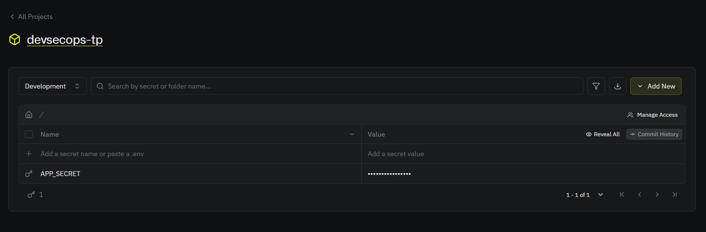
*Figure 7 – Secret `APP_SECRET` dans le projet Infisical (environnement Development, valeur masquée)*

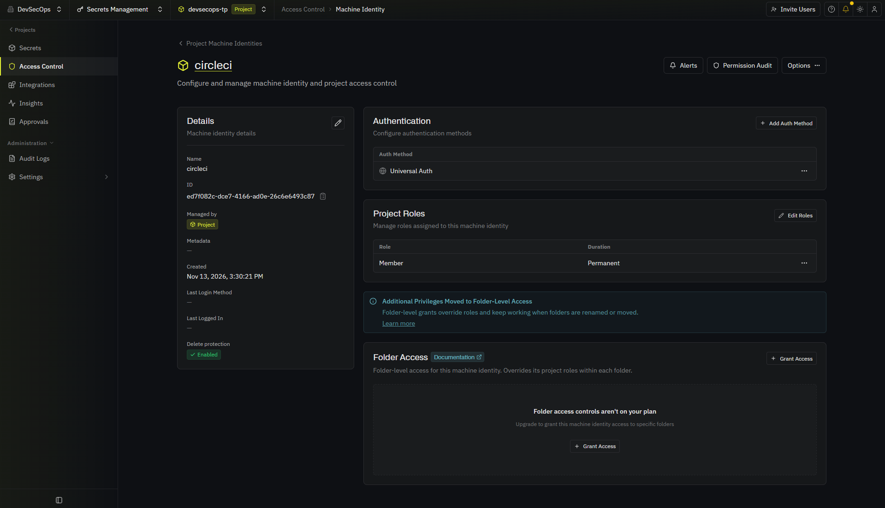
*Figure 8 – Identité machine `circleci` (Universal Auth, rôle Member sur le projet)*

#### Intégration dans le pipeline

Le **Client ID** et le **Client Secret** sont enregistrés dans CircleCI sous forme de variables d'environnement (jamais dans le dépôt) :

| Variable | Contenu |
|---|---|
| `INFISICAL_CLIENT_ID` | Identifiant de l'identité machine |
| `INFISICAL_CLIENT_SECRET` | Secret de l'identité machine |

Un job `security-infisical-check` a été ajouté à `main_workflow`. Il :

1. installe le client **Infisical CLI** ;
2. s'authentifie avec `infisical login --method=universal-auth` pour obtenir un jeton d'accès temporaire ;
3. exécute `infisical run --projectId <id> --env dev -- ...` qui injecte les secrets du projet dans l'environnement d'une commande, et vérifie que `APP_SECRET` est bien disponible ;
4. n'affiche **jamais** la valeur du secret dans les logs.

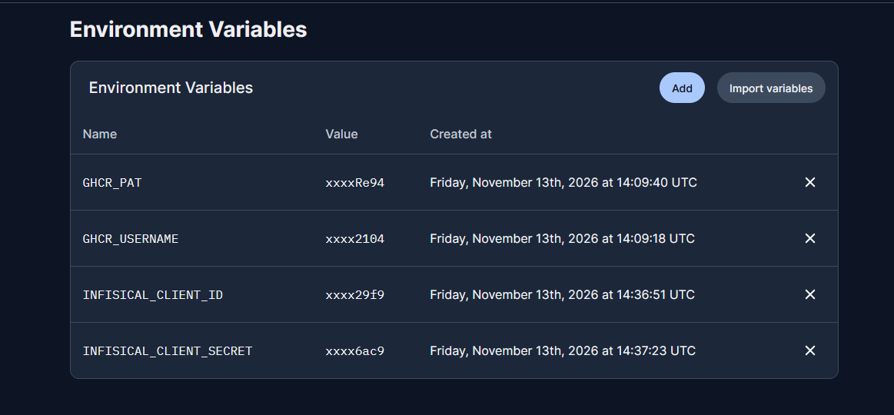
*Figure 9 – Variables CircleCI : identifiants GHCR et Infisical (valeurs masquées)*

Seuls l'identifiant du projet et le nom de l'environnement figurent dans le fichier `config.yml` ; ce ne sont pas des informations sensibles.

Le job réussit en 13 secondes : l'authentification et la lecture du secret fonctionnent. Le client Infisical étant déjà présent dans l'image Docker (voir 1.2), le conteneur pourra lancer l'application avec `infisical run` pour recevoir `APP_SECRET` au démarrage, ce qui sera utilisé lors du déploiement en production (partie 3.3).

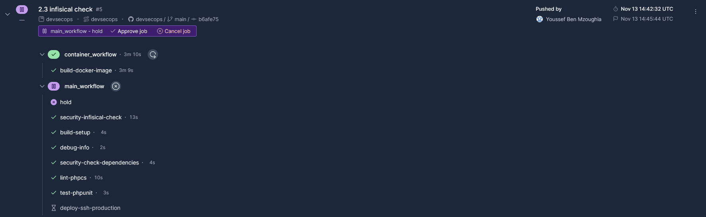
*Figure 10 – Job `security-infisical-check` réussi dans `main_workflow`*


## Partie 3 – Extension du pipeline

Quatre jobs ont été ajoutés à `main_workflow`. Chacun dépend de `build-setup`, s'exécute dans son propre conteneur (`cimg/php:8.2`) en parallèle des autres vérifications, installe son outil avec Composer en **version fixée** (pour des résultats reproductibles) et publie son rapport en **artefact** CircleCI. Les commandes ont d'abord été testées localement dans la même image avant d'être intégrées au pipeline.

### 3.1 Jobs d'évaluation du code

| Job | Outil | Rôle |
|---|---|---|
| `metrics-phpmetrics` | `phpmetrics/phpmetrics` 2.11.0 | Calcule des métriques de qualité (complexité cyclomatique, maintenabilité, couplage, bugs estimés) et génère un rapport HTML et JSON. |
| `metrics-phploc` | `phploc/phploc` 7.0.2 | Mesure la taille du projet (lignes de code, lignes de commentaires, classes, méthodes). |

```bash
phpmetrics --report-html=phpmetrics-report --report-json=phpmetrics-report.json src
phploc src | tee phploc-report.txt
```

Le rapport PhpMetrics est publié sous forme de site HTML consultable (dossier `phpmetrics-report`).

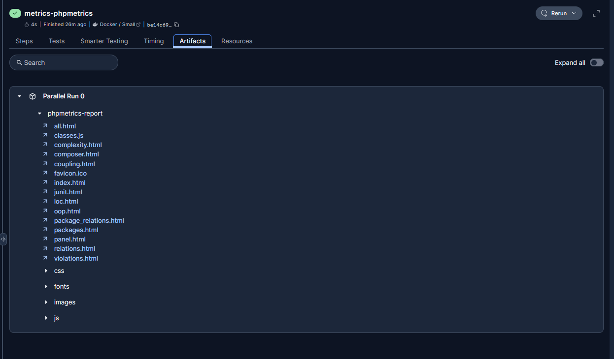
*Figure 11 – Artefacts du job `metrics-phpmetrics` (rapport HTML)*

Sur le projet, le rapport indique : 0 violation, 1 classe (`App\ImageCreator`), une complexité cyclomatique moyenne de 2,00 par classe et environ 0,15 bug estimé par classe, ce qui correspond à un code très simple et facile à maintenir. `phploc` donne de son côté 70 lignes de code dont 6 lignes de commentaires (les deux outils ne comptent pas les lignes de la même façon).

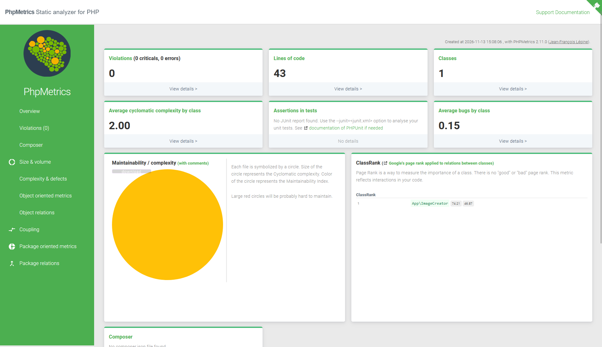
*Figure 12 – Rapport PhpMetrics ouvert dans un navigateur*

### 3.2 Intégration de la qualité du code

| Job | Outil | Rôle |
|---|---|---|
| `lint-phpmd` | `phpmd/phpmd` 3.0.0 | Détecte les mauvaises pratiques (code complexe, noms trop courts, variables inutilisées, usage de superglobales…) avec les jeux de règles `cleancode`, `codesize`, `controversial`, `design`, `naming` et `unusedcode`. |
| `lint-php-doc-check` | `niels-de-blaauw/php-doc-check` 0.4.1 | Vérifie que les fonctions et méthodes sont documentées (PHPDoc). |

```bash
phpmd src text cleancode,codesize,controversial,design,naming,unusedcode
php-doc-check src
```

**Choix de conception.** PHPMD retourne le code de sortie 2 lorsqu'il trouve des violations. Le job accepte ce code (0 ou 2) afin de publier le rapport **sans bloquer** le pipeline, comme le fait déjà `lint-phpcs`, mais échoue pour tout autre code d'erreur (échec de l'outil). Les scripts utilisent `set -eo pipefail` pour qu'une erreur ne soit pas masquée par un `tee`. L'installation de `php-doc-check` est faite dans un job séparé car cet outil est en conflit de dépendances avec les autres si on les installe ensemble.

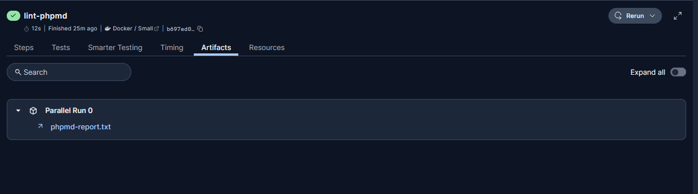
*Figure 13 – Artefact `phpmd-report.txt` du job `lint-phpmd`*

PHPMD relève trois problèmes réels dans `src/ImageCreator.php` :

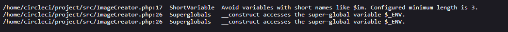
*Figure 14 – Contenu de `phpmd-report.txt`*

| Ligne | Règle | Problème |
|---|---|---|
| 17 | `ShortVariable` | La propriété `$im` a un nom trop court. |
| 26 (×2) | `Superglobals` | Le constructeur lit directement la superglobale `$_ENV`. |

`php-doc-check` ne signale aucune méthode non documentée.

#### Résultat

Les quatre nouveaux jobs s'exécutent avec succès à côté des jobs existants ; `main_workflow` s'arrête toujours sur `hold` (approbation manuelle avant le déploiement).

Lors de ce run, `build-docker-image` a échoué une première fois pendant l'envoi de l'image vers GHCR (`unknown blob`) : il s'agit d'une erreur transitoire du registre (l'image fait environ 1,1 Go), sans lien avec la configuration, puisque le même job avait déjà réussi avec le même code. Un simple **re-run** du workflow a suffi, comme le montre l'historique ci-dessous (tentative échouée, puis re-run réussi).

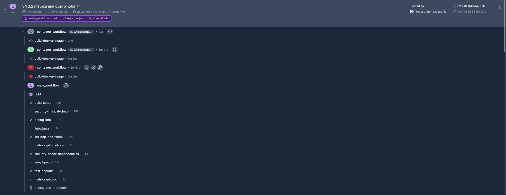
*Figure 15 – Pipeline complet : jobs de métriques et de qualité verts, `hold` en attente, `build-docker-image` réussi après re-run*


### 3.3 Déploiement automatisé sur AWS EC2

#### Infrastructure

Le déploiement cible une instance **AWS EC2** (région `eu-west-3`, Paris) de type `t3.micro`, avec une **adresse IP élastique** : l'adresse publique ne change pas si l'instance est redémarrée, ce qui permet de la déclarer une fois pour toutes dans CircleCI. L'instance impose **IMDSv2** (protection contre le vol de métadonnées via des requêtes SSRF). Le serveur exécute **Nginx** relié à **PHP 8.3-FPM** par socket Unix (racine : `/var/www/php-devops-tp/public`) ; le code est cloné par HTTPS dans `/var/www/php-devops-tp` et appartient à l'utilisateur dédié `deploy` (le dépôt étant public, aucune clé de déploiement GitHub n'est nécessaire).

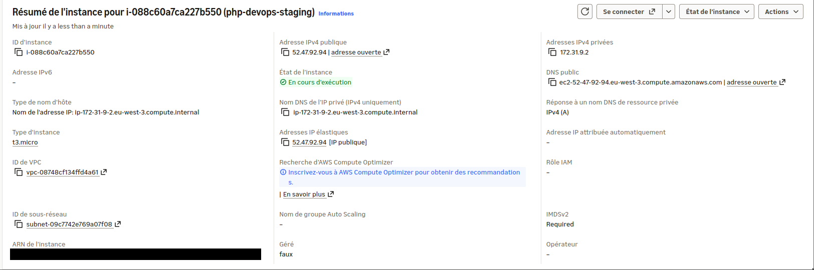
*Figure 16 – Instance EC2 et adresse IP élastique (identifiant du compte AWS masqué)*

#### Authentification SSH par clé

CircleCI se connecte au serveur avec une **paire de clés SSH** dédiée au déploiement :

| Élément | Emplacement |
|---|---|
| Clé **publique** | `~deploy/.ssh/authorized_keys` sur le serveur |
| Clé **privée** | *Project Settings → SSH Keys* de CircleCI, associée à l'adresse IP du serveur. Elle n'est jamais écrite dans le dépôt. |
| Empreinte (*fingerprint*) | Affichée par CircleCI, utilisée dans le `config.yml` pour sélectionner la clé (ce n'est pas un secret) |

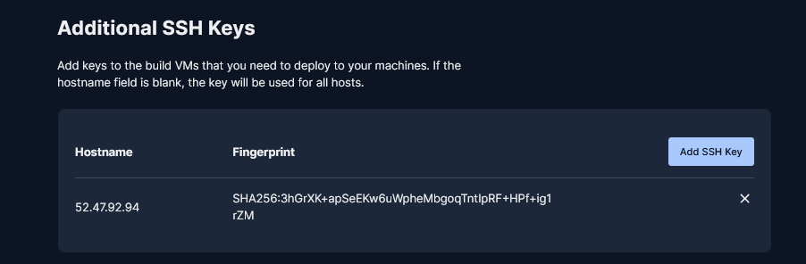
*Figure 17 – Clé SSH ajoutée dans CircleCI (hôte et empreinte)*

L'empreinte est écrite **en clair** dans le fichier de configuration, car CircleCI n'interpole pas les variables d'environnement dans `add_ssh_keys`.

Le serveur est durci dans `/etc/ssh/sshd_config.d/99-hardening.conf` : `PasswordAuthentication no` et `PermitRootLogin no`. Une tentative de connexion sans la bonne clé renvoie `Permission denied (publickey)`, et seule la méthode `publickey` est proposée (si le mot de passe était actif, le serveur afficherait `publickey,password`).

#### Variables CircleCI

| Variable | Rôle |
|---|---|
| `PRODUCTION_SSH_HOST` | Adresse IP du serveur |
| `PRODUCTION_SSH_USER` | Utilisateur SSH (`deploy`) |
| `PRODUCTION_DEPLOY_DIRECTORY` | Dossier de l'application sur le serveur |
| `STAGING_SSH_HOST`, `STAGING_SSH_USER`, `STAGING_DEPLOY_DIRECTORY` | Mêmes informations pour la préproduction (ici, elles pointent vers la même instance) |

#### Le job `deploy-ssh-production`

Pour éviter de dupliquer le code entre préproduction et production, le déploiement est écrit **une seule fois** dans une commande réutilisable (`deploy-over-ssh`) paramétrée par l'empreinte, l'utilisateur, l'hôte et le dossier. Les deux jobs `deploy-ssh-staging` et `deploy-ssh-production` l'appellent avec leurs propres variables. Les étapes sont :

1. `add_ssh_keys` : charge la clé privée correspondant à l'empreinte ;
2. `Trust EC2 host key` : `ssh-keyscan -H` enregistre la clé d'hôte du serveur dans `known_hosts` ;
3. `Deploy to AWS EC2` : ouvre une session SSH et exécute, **sur le serveur**, le script suivant :

```bash
set -euo pipefail
cd "$DEPLOY_DIR"
git fetch origin
git checkout "$DEPLOY_BRANCH"
git pull --ff-only origin "$DEPLOY_BRANCH"
composer install --no-dev --optimize-autoloader --no-interaction --prefer-dist
PHP_FPM_VERSION=$(php -r 'echo PHP_MAJOR_VERSION.".".PHP_MINOR_VERSION;')
(flock -w 10 9 || exit 1; sudo service "php${PHP_FPM_VERSION}-fpm" restart) 9>/tmp/fpm.lock
```

#### Workflow et garde-fous

Le job `hold` (approbation manuelle) dépend désormais de **tous les jobs de contrôle** (`lint-phpcs`, `security-check-dependencies`, `test-phpunit`, `security-infisical-check`, `metrics-phpmetrics`, `metrics-phploc`, `lint-phpmd`, `lint-php-doc-check`). Il est donc impossible d'approuver un déploiement tant qu'un contrôle est en échec ou n'est pas terminé. `deploy-ssh-production` ne s'exécute qu'après approbation, et seulement sur les branches `main` et `master`.

#### Bonnes pratiques de sécurité et de performance appliquées

| Pratique | Raison |
|---|---|
| Approbation manuelle avant la production | Évite un déploiement involontaire |
| Authentification SSH par clé, mot de passe désactivé | Pas de mot de passe à deviner ou à voler |
| Clé privée stockée uniquement dans CircleCI | Absente du dépôt et des logs |
| `ssh-keyscan` au lieu de `StrictHostKeyChecking=no` | Évite de désactiver complètement la vérification de l'hôte |
| `BatchMode=yes` | La connexion échoue au lieu de rester bloquée sur une question |
| Heredoc entre guillemets : le script s'exécute entièrement sur le serveur | Aucune variable évaluée par erreur sur le runner |
| `set -euo pipefail` | Le déploiement s'arrête à la première erreur |
| `git pull --ff-only` | Refuse tout état de dépôt inattendu (pas de fusion implicite) |
| `composer install --no-dev --optimize-autoloader` | Aucun outil de développement en production, autoload plus rapide |
| `flock` autour du redémarrage de PHP-FPM | Empêche deux déploiements simultanés de redémarrer le service en même temps |
| Version de PHP-FPM détectée sur le serveur | Pas de version codée en dur |

#### Difficultés rencontrées

1. **Variable PHP vide.** Dans le job d'origine, `$(php -v ...)` était évalué sur le runner CircleCI (qui n'a pas PHP) au lieu du serveur, car le heredoc n'était pas protégé : la version de PHP-FPM arrivait vide. Corrigé en protégeant le heredoc et en détectant la version sur le serveur.
2. **Erreur de configuration `Unclosed '<<' tag`.** Le heredoc `<<'EOF'` entre en conflit avec la syntaxe `<< parameters.x >>` de CircleCI 2.1 : il doit être écrit `\<<'EOF'`. Le pipeline était refusé avant de démarrer. L'erreur a été reproduite et corrigée localement avec le validateur officiel (`circleci config validate`), outil utilisé ensuite avant chaque modification du fichier.
3. **Empreinte non interpolable.** `add_ssh_keys` n'accepte pas de variable d'environnement : l'empreinte est passée comme paramètre de la commande réutilisable.

#### Résultat

Après approbation du job `hold`, `deploy-ssh-production` s'exécute avec succès (6 secondes). Le journal montre le `git fetch`, la mise à jour en avance rapide (*fast-forward*) du dépôt, puis `composer install` et la régénération de l'autoloader optimisé.

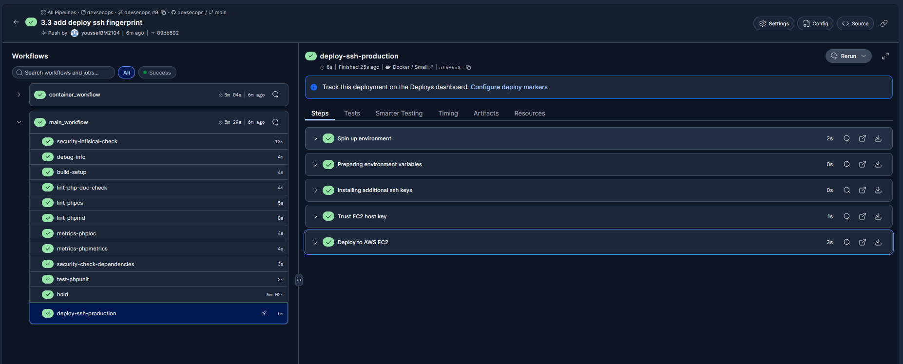
*Figure 18 – Pipeline complet : tous les contrôles verts, `hold` approuvé, `deploy-ssh-production` réussi*

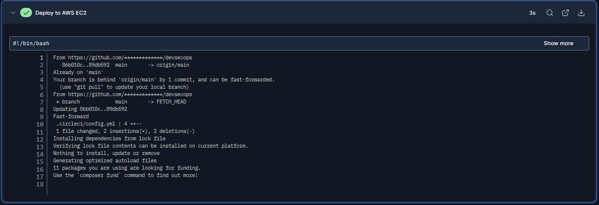
*Figure 19 – Journal de l'étape « Deploy to AWS EC2 »*

L'application est ensuite accessible à l'adresse publique du serveur et renvoie bien l'image PNG générée (`http://52.47.92.94`).

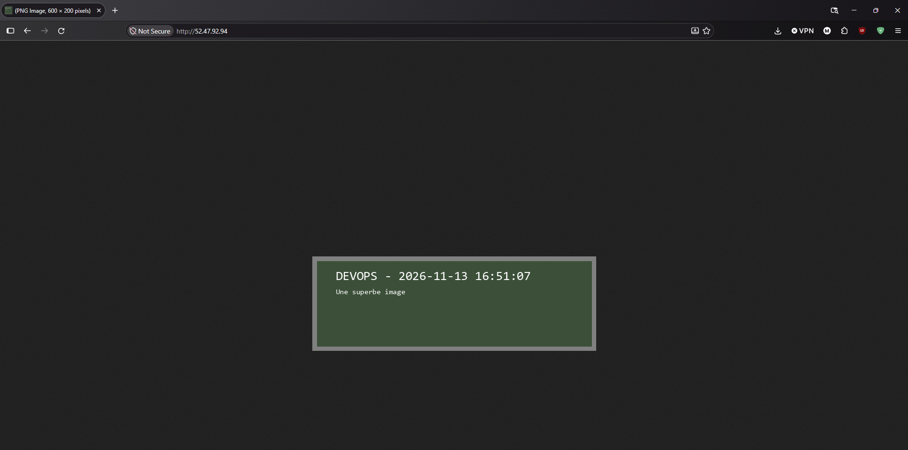
*Figure 20 – Application déployée sur EC2 (image PNG 600×200)*

#### Limites constatées

- L'application est servie en **HTTP** (navigateur : « Not Secure ») : il manque un certificat TLS.
- Le déploiement actuel **n'utilise pas l'image Docker** construite et publiée sur GHCR : le serveur met à jour le code par `git pull`. L'image et le déploiement forment deux chaînes distinctes.
- `APP_SECRET` n'est pas injecté sur le serveur (le texte « secret » n'apparaît pas dans l'image) : le lien avec Infisical n'existe qu'en CI.
- `ssh-keyscan` fait confiance à la première clé d'hôte reçue ; l'idéal est de comparer son empreinte avec celle du serveur.
- Le port 22 est ouvert à Internet (`0.0.0.0/0` dans le groupe de sécurité `php-devops-sg`, comme les ports 80 et 443), car les adresses IP de CircleCI sont variables. La protection repose sur l'authentification par clé uniquement, complétée sur le serveur par un utilisateur `deploy` dédié dont le `sudo` est limité à `service php*-fpm restart`, **fail2ban** et le pare-feu **ufw**.
- **Préproduction et production sur la même instance** (même IP, même utilisateur `deploy`, même dossier). C'est un choix assumé pour le TP : la production déploie la branche `main`, la préproduction les branches `release/*`, et chaque déploiement passe par l'approbation manuelle `hold`. En situation réelle, il faudrait deux instances séparées ; le nom « php-devops-staging » de l'instance est historique et ne désigne pas un vrai environnement de préproduction.
- **Écart entre environnements** : l'image Docker utilise Apache avec PHP 8.2 (`php:8.2-apache`), tandis que le serveur EC2 utilise Nginx avec PHP 8.3-FPM, et la CI PHP 8.2. Ce qui est testé n'est donc pas strictement identique à ce qui tourne en production.
- Le port 443 est ouvert, mais l'application n'est servie qu'en HTTP : aucun certificat TLS n'est encore configuré.


## Partie 4 – Documentation et rapport

### 4.1 Documentation du processus

#### Vue d'ensemble

À chaque `git push` sur GitHub, CircleCI exécute le fichier `.circleci/config.yml`. Celui-ci définit deux workflows indépendants :

- **`main_workflow`** : intégration continue (installation, tests, qualité, sécurité, métriques) puis, après approbation manuelle, déploiement sur AWS EC2 ;
- **`container_workflow`** : construction de l'image Docker et publication sur GHCR.

Le schéma complet figure en 4.2.

#### Structure du fichier `config.yml`

| Section | Contenu |
|---|---|
| `executors` | Environnements d'exécution : `php-executor` (`cimg/php:8.2`), `builder-executor` (`cimg/php:8.2-node`), `simple-executor` (`cimg/base:stable`). Tous en classe de ressource `small`. |
| ancres YAML | `persist_to_workspace` et `attach_workspace` : partagent le code et le dossier `vendor` entre les jobs sans les réinstaller. |
| `commands` | `deploy-over-ssh` : commande réutilisable qui déploie le code par SSH (paramètres : empreinte de clé, utilisateur, hôte, dossier). |
| `jobs` | Les 13 jobs décrits ci-dessous. |
| `workflows` | `main_workflow` et `container_workflow`, avec leurs dépendances (`requires`) et leurs filtres de branches. |

Convention de nommage des jobs, indiquée dans le fichier : un préfixe indique la nature du job (`build-`, `lint-`, `test-`, `security-`, `metrics-`, `deploy-`).

#### Les jobs

| Job | Exécuteur | Rôle | Artefacts |
|---|---|---|---|
| `debug-info` | php | Affiche l'environnement d'exécution (utile au diagnostic) | – |
| `build-setup` | php | `checkout`, cache Composer, `composer install`, partage du workspace | workspace |
| `lint-phpcs` | php | Style de code PSR-12 et compatibilité PHP (PHP_CodeSniffer, `phpcs.xml`) ; ne bloque pas le pipeline | `phpcs-report` |
| `security-check-dependencies` | php | Recherche de vulnérabilités connues dans `composer.lock` (`local-php-security-checker`) | `security-report` |
| `test-phpunit` | php | Tests unitaires (`--testsuite=Unit`) | – |
| `security-infisical-check` | simple | Authentification à Infisical (Universal Auth) et vérification que `APP_SECRET` est lisible, sans l'afficher | – |
| `metrics-phpmetrics` | php | Métriques de qualité (complexité, maintenabilité, couplage) | `phpmetrics-report` |
| `metrics-phploc` | php | Métriques de taille du code | `phploc-report.txt` |
| `lint-phpmd` | php | Détection de mauvaises pratiques (PHPMD) ; ne bloque pas le pipeline | `phpmd-report.txt` |
| `lint-php-doc-check` | php | Vérification de la documentation PHPDoc | `php-doc-check-report.txt` |
| `build-docker-image` | builder | Construction de l'image avec `Docker/Dockerfile` et publication sur GHCR | – |
| `deploy-ssh-staging` | simple | Déploiement SSH (préproduction) | – |
| `deploy-ssh-production` | simple | Déploiement SSH (production) | – |

#### Les workflows

**`main_workflow`**

1. `debug-info` et `build-setup` démarrent ensemble. `security-infisical-check` démarre aussi seul (il n'a pas besoin du code).
2. Dès que `build-setup` est terminé, sept jobs s'exécutent en **parallèle** : `lint-phpcs`, `security-check-dependencies`, `test-phpunit`, `metrics-phpmetrics`, `metrics-phploc`, `lint-phpmd`, `lint-php-doc-check`.
3. Le job `hold` (type `approval`) attend que **tous les contrôles** soient terminés avec succès, puis attend une **approbation manuelle** dans l'interface CircleCI. Il n'existe que sur les branches `main`, `master` et `release/*`.
4. Après approbation : `deploy-ssh-production` (branches `main` et `master`) ou `deploy-ssh-staging` (branches `release/*`).

**`container_workflow`** : `build-docker-image` s'exécute sur les branches `main`, `master`, `develop`, `feature/*`, `release/*`, `hotfix/*` et `bugfix/*`. L'image est publiée sous le nom `ghcr.io/<utilisateur>/<dépôt>:<branche>` (nom en minuscules, branche nettoyée).

#### Variables et secrets

| Variable (CircleCI, *Project Settings → Environment Variables*) | Utilisée par | Contenu |
|---|---|---|
| `GHCR_USERNAME` | `build-docker-image` | Utilisateur GitHub |
| `GHCR_PAT` | `build-docker-image` | Jeton GitHub avec la permission `write:packages` |
| `INFISICAL_CLIENT_ID`, `INFISICAL_CLIENT_SECRET` | `security-infisical-check` | Identifiants de l'identité machine Infisical (Universal Auth) |
| `STAGING_SSH_HOST`, `STAGING_SSH_USER`, `STAGING_DEPLOY_DIRECTORY` | `deploy-ssh-staging` | Cible du déploiement de préproduction |
| `PRODUCTION_SSH_HOST`, `PRODUCTION_SSH_USER`, `PRODUCTION_DEPLOY_DIRECTORY` | `deploy-ssh-production` | Cible du déploiement de production |
| Clé SSH privée (*Project Settings → SSH Keys*) | les deux jobs de déploiement | Clé de connexion au serveur, sélectionnée par son empreinte |

Aucun secret ne figure dans le dépôt Git. Le secret de l'application (`APP_SECRET`) est géré dans Infisical.

#### Procédures

**Lancer le pipeline** : pousser un commit sur GitHub. Les deux workflows démarrent automatiquement.

**Déployer en production** : pousser sur `main`, attendre que les contrôles de `main_workflow` soient verts, ouvrir le pipeline dans CircleCI, puis cliquer sur **Approve job** sur `hold`.

**Ajouter un job** :
1. définir le job sous `jobs:` avec un nom respectant la convention (préfixe + outil) ;
2. commencer par `- *attach_workspace` pour récupérer le code et `vendor` ;
3. installer l'outil avec une **version fixée** (`composer global require paquet:x.y.z`) ;
4. publier le rapport avec `store_artifacts` ;
5. déclarer le job dans `workflows`, avec `requires: [build-setup]` ;
6. **valider le fichier avant le push** avec `circleci config validate`.

**Relancer un job échoué** : dans CircleCI, *Rerun → Rerun failed jobs*. Cela a suffi, par exemple, pour une erreur transitoire de GHCR (`unknown blob`).

**Diagnostiquer un déploiement qui échoue** :

| Symptôme | Cause probable |
|---|---|
| Erreur à l'étape `Trust EC2 host key` | Mauvaise adresse dans `*_SSH_HOST` ou port 22 fermé |
| `Permission denied (publickey)` | La clé publique n'est pas dans `authorized_keys`, ou la mauvaise empreinte est utilisée |
| Erreur à `composer install` | PHP ou Composer absent du serveur, ou extension `gd` manquante |
| `sudo` demande un mot de passe | La règle `sudoers` pour `service php*-fpm restart` est absente |

### 4.2 Rapport final

#### Schéma récapitulatif du pipeline

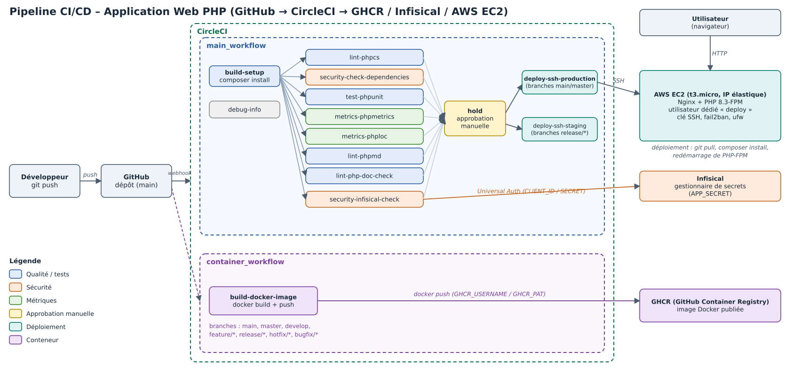
*Figure 21 – Fonctionnement du pipeline CI/CD*

#### Défis rencontrés et solutions apportées

| # | Défi | Solution |
|---|---|---|
| 1 | Le pipeline était refusé : `Cannot find a definition for job named deploy-ssh-production` | Écriture du job de déploiement en production (partie 3.3) |
| 2 | `docker build -f docker/Dockerfile` échouait (`lstat docker: no such file`) : Linux est sensible à la casse | Chemin corrigé en `Docker/Dockerfile` |
| 3 | La construction de l'image échouait à l'installation d'Infisical (`Unable to locate package infisical`) : l'adresse du dépôt de paquets renvoyait une erreur 404, masquée par `curl \| bash` | Nouvelle adresse du script d'installation (`artifacts-cli.infisical.com`) |
| 4 | Les exécuteurs utilisaient PHP 8.1 alors que `composer.json` exige PHP ≥ 8.2 | Images `cimg/php:8.2` |
| 5 | `test-phpunit` échouait : `composer require phpunit/phpunit` sans contrainte choisissait PHPUnit 13, incompatible | Étape supprimée (PHPUnit est déjà installé par `build-setup`). Cause trouvée en **reproduisant le job localement** |
| 6 | `build-docker-image` rejeté : version de Remote Docker obsolète et mise en cache de couches indisponible sur le plan gratuit | `version: default` et suppression de `docker_layer_caching` |
| 7 | L'image démarrait mais l'application échouait (`vendor/autoload.php` introuvable) : `vendor` est exclu par `.dockerignore` | `composer install` exécuté dans le conteneur (documenté en 1.2) |
| 8 | Conflit de dépendances en installant les quatre outils de qualité ensemble (`php-doc-check`) | Un job par outil, chacun dans son conteneur, avec versions fixées |
| 9 | PHPMD retourne le code 2 en cas de violations, ce qui aurait fait échouer le job, et un `tee` masquait les erreurs | Code 0 ou 2 accepté, tout autre code échoue ; `set -eo pipefail` |
| 10 | Erreur transitoire de GHCR (`unknown blob`) pendant le push de l'image (1,1 Go) | Re-run du workflow (la configuration n'était pas en cause) |
| 11 | Déploiement d'origine défaillant : variables évaluées sur le runner CircleCI au lieu du serveur, `StrictHostKeyChecking=no`, étape `deploy` dépréciée | Heredoc protégé exécuté sur le serveur, `ssh-keyscan`, étapes `run` |
| 12 | `Unclosed '<<' tag` : le heredoc entre en conflit avec la syntaxe des paramètres de CircleCI 2.1 | Écriture `\<<'EOF'`, validation avec `circleci config validate` |
| 13 | L'empreinte de la clé SSH ne peut pas venir d'une variable d'environnement | Empreinte passée comme paramètre de la commande réutilisable |
| 14 | Lecture d'une empreinte sur une capture d'écran : `I` majuscule et `l` minuscule indiscernables | Empreinte copiée en texte (jamais retranscrite à l'œil) |

#### Résultats obtenus

- Un pipeline qui s'exécute à chaque `push`, avec **13 jobs** et **2 workflows**, tous verts.
- Des **contrôles automatiques** : style de code, tests, analyse des dépendances, détection de mauvaises pratiques, documentation du code, et vérification de l'accès aux secrets.
- Des **rapports** (métriques, analyses) conservés comme artefacts de chaque exécution.
- Une **image Docker** construite automatiquement et publiée sur GHCR.
- Une gestion des **secrets** centralisée dans Infisical, sans secret dans le dépôt.
- Un **déploiement continu** vers AWS EC2, protégé par une approbation manuelle qui n'est possible que lorsque tous les contrôles ont réussi.
- L'application est accessible en production et renvoie l'image PNG attendue.

#### Enseignements

- **Reproduire localement** (dans la même image Docker que la CI) permet de trouver la vraie cause d'un échec avant de modifier la configuration : c'est ce qui a permis de corriger `test-phpunit` et de valider les quatre nouveaux jobs.
- **Valider la configuration avec l'outil officiel** (`circleci config validate`) avant chaque push évite les pipelines refusés.
- **Figer les versions** des outils rend les résultats reproductibles.
- Des limites restent à traiter et constituent des pistes d'amélioration : HTTPS, image Docker non utilisée pour le déploiement, secret non injecté en production, environnements non identiques (voir « Limites constatées » en 3.3).
