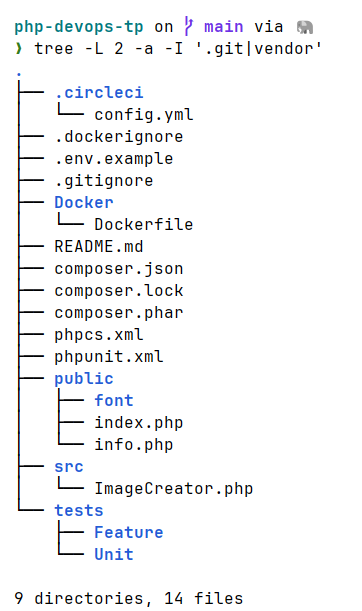
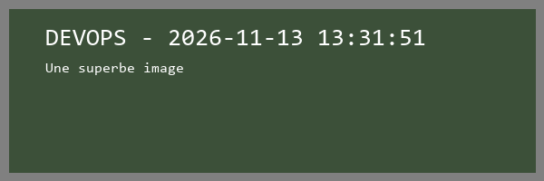
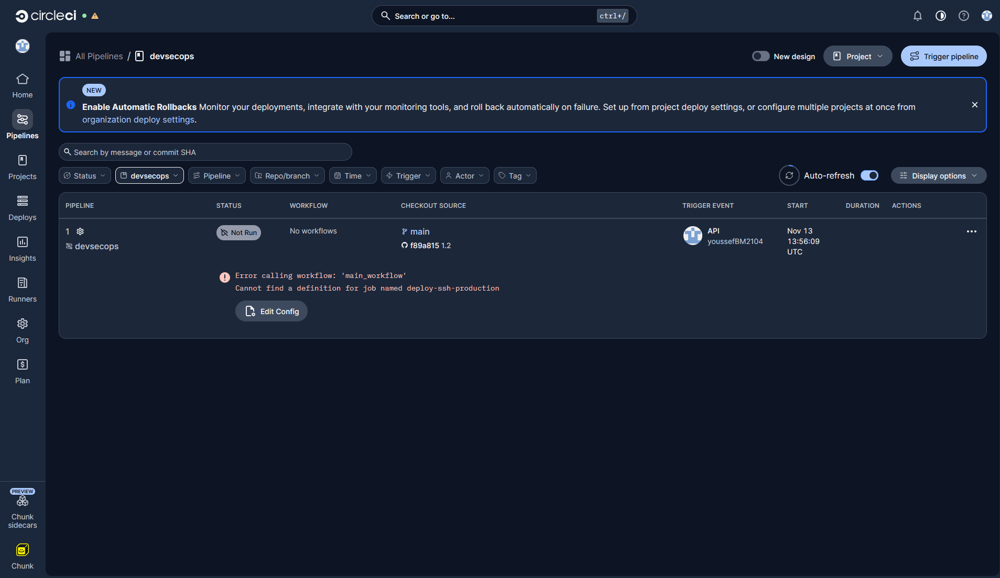
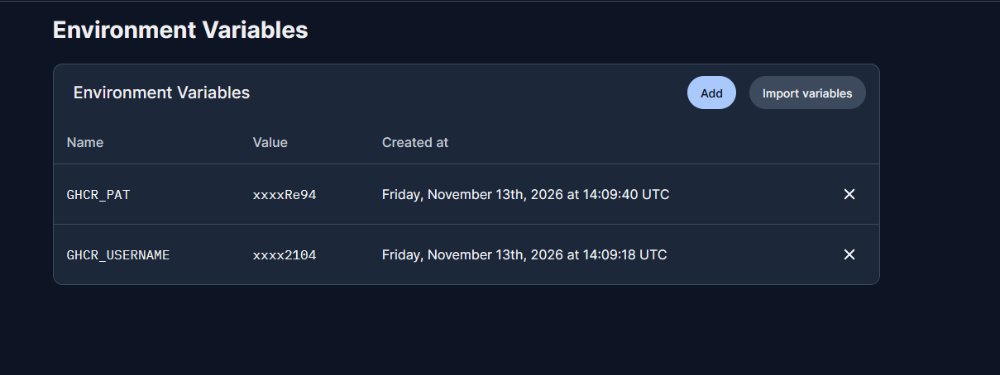
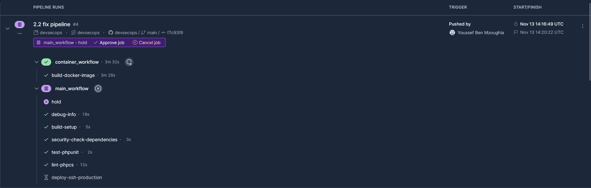
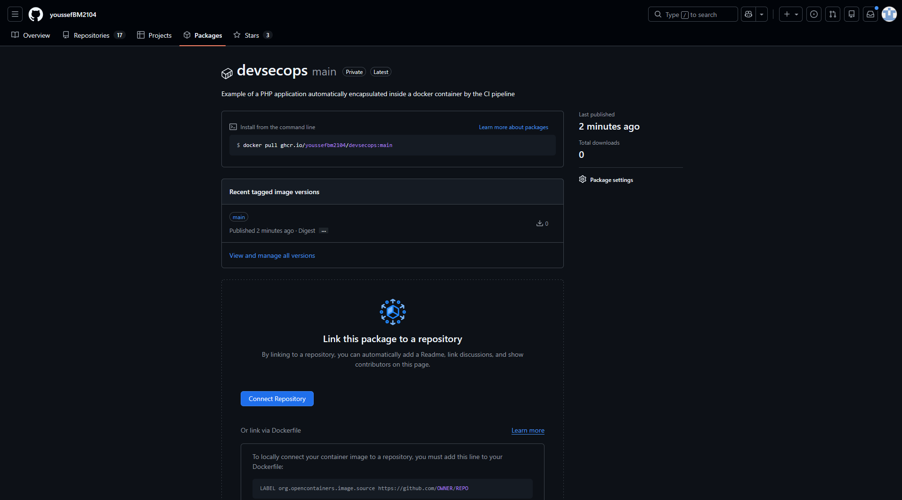

# Rapport TP03 – Pipeline CI/CD pour une application Web PHP

**Module :** DevSecOps – SI5
**Groupe :** _Nom1 / Nom2 / Nom3 / Nom4_ (à compléter)
**Date :** 13/11/2026

---

## Partie 1 – Compréhension et configuration de base

### 1.1 Analyse du projet PHP

#### Vue d'ensemble

Le projet est une petite application Web PHP dont l'unique fonctionnalité est de **générer dynamiquement une image PNG** (600×200 px) contenant du texte. Les dépendances sont gérées avec **Composer**.

#### Arborescence


*Figure 1 – Arborescence du projet (`tree -L 2 -a -I '.git|vendor'`)*

| Élément | Rôle |
|---|---|
| `public/index.php` | Point d'entrée Web. Charge l'autoloader et le fichier `.env`, envoie l'en-tête `Content-type: image/png`, puis instancie `ImageCreator` et génère l'image. |
| `public/info.php` | Appelle `phpinfo()` (page de diagnostic de la configuration PHP). |
| `public/font/consolas.ttf` | Police TrueType utilisée pour écrire le texte dans l'image. |
| `src/ImageCreator.php` | Classe métier (espace de noms `App`) qui dessine l'image avec l'extension GD. |
| `tests/Unit`, `tests/Feature` | Tests PHPUnit (actuellement deux tests d'exemple `assertTrue(true)`). |
| `composer.json` / `composer.lock` | Dépendances et versions verrouillées. |
| `phpunit.xml` | Configuration des tests (suites `Unit` et `Feature`). |
| `phpcs.xml` | Règles de qualité de code : PSR-12 + PHPCompatibility. |
| `Docker/Dockerfile` | Image Docker de l'application (`php:8.2-apache`). |
| `.circleci/config.yml` | Définition du pipeline CI/CD. |
| `.env.example` | Modèle de fichier d'environnement (variable `APP_SECRET`). |

#### Fonctionnement du code

La classe `App\ImageCreator` :

1. crée une image vraie couleur 600×200 avec `imagecreatetruecolor` ;
2. alloue trois couleurs (blanc, couleur 1, couleur 2) via `imagecolorallocate` ;
3. construit un premier texte `"<texte> - <date et heure>"` grâce à la bibliothèque **Carbon** ;
4. construit un second texte, auquel est **ajoutée la valeur de `$_ENV['APP_SECRET']`** si elle est définie ;
5. dans `createImage()`, dessine deux rectangles imbriqués (`imagefilledrectangle`), écrit les textes avec `imagettftext`, puis envoie le PNG sur la sortie standard (`imagepng`).

`index.php` fixe les couleurs et les textes puis délègue tout à cette classe. La variable `APP_SECRET` est lue depuis l'environnement ou le fichier `.env` (via `vlucas/phpdotenv`) : c'est le **secret de démonstration** qui sera géré par Infisical dans la partie 2.3.

#### Dépendances (Composer)

- **Exécution :** PHP ≥ 8.2, extension `ext-gd`, `nesbot/carbon` 2.72.1 (gestion des dates), `vlucas/phpdotenv` 5.6.0 (chargement du `.env`).
- **Développement :** `phpunit/phpunit` 10.5.2 (tests) et `roave/security-advisories` (empêche l'installation de paquets ayant une faille de sécurité connue).
- L'autoloading est de type PSR-4 : `App\` → `src/` et `Tests\` → `tests/`.


### 1.2 Configuration de l'environnement Docker

#### Le Dockerfile (`Docker/Dockerfile`)

L'image est basée sur `php:8.2-apache` (PHP 8.2 conforme à `composer.json`, Apache comme serveur Web). Les principales étapes sont :

| Étape | Rôle |
|---|---|
| `ARG` / `LABEL` | Métadonnées OCI (date de build, commit Git, URL du dépôt, version) injectées par le pipeline via `--build-arg`. |
| Dépendances système | Bibliothèques nécessaires à GD (`libpng`, `libjpeg`, `libfreetype`), `libzip`, `unzip`, `wget`. |
| SQLite | Compilation de SQLite depuis les sources (version paramétrable). |
| Xdebug | Installation de Xdebug 3.3.0 via PECL. |
| Extensions PHP | `gd` (avec FreeType et JPEG), `pdo`, `pdo_mysql`, `zip`, `pdo_sqlite`. |
| Infisical CLI | Installation du client de gestion de secrets (utilisé en partie 2.3). |
| Composer | Installation de Composer dans l'image. |
| Apache | Activation de `mod_rewrite` et remplacement du `DocumentRoot` par `/var/www/html/public`. |
| `COPY . /var/www/html` | Copie du code ; `.dockerignore` exclut `vendor`, `.git`, `.env*`, `Docker`, etc. |
| Permissions | `chown www-data` sur le dossier de l'application, port `80` exposé. |

#### Construction de l'image

```bash
cd php-devops-tp
docker build -f Docker/Dockerfile -t php-devops-tp:local .
```

Deux problèmes ont été rencontrés lors du premier build :

1. **Chemin du Dockerfile** : le pipeline utilise `-f docker/Dockerfile` (minuscule) alors que le dossier s'appelle `Docker`. Sous Linux (sensible à la casse), le build échoue : `lstat docker: no such file or directory`. La commande correcte est `-f Docker/Dockerfile` (à corriger dans le pipeline, partie 2.2).
2. **Installation d'Infisical** : le script `https://dl.cloudsmith.io/public/infisical/infisical-cli/setup.deb.sh` renvoie désormais une erreur 404 (le dépôt a changé d'adresse). Comme le script est passé à `bash` via un `curl | bash`, l'erreur est silencieuse et c'est `apt-get install infisical` qui échoue plus loin (`Unable to locate package infisical`). **Correction :** utilisation de la nouvelle adresse `https://artifacts-cli.infisical.com/setup.deb.sh`.

Après ces corrections, l'image se construit correctement (environ 1,1 Go).

#### Exécution locale

```bash
docker run -d --name tp-php -p 8080:80 php-devops-tp:local
```

Un premier appel à `http://localhost:8080/` affiche une erreur : `Failed to open stream: vendor/autoload.php`. En effet le dossier `vendor` est exclu par `.dockerignore` et le Dockerfile n'exécute pas `composer install` : les dépendances doivent donc être installées dans le conteneur (ou montées via un volume) :

```bash
docker exec -u www-data tp-php composer install --no-interaction --no-dev --optimize-autoloader
```

Après cette commande, `http://localhost:8080/` renvoie bien une image PNG de 600×200 px (code HTTP 200, `Content-Type: image/png`) affichant le texte « DEVOPS » suivi de la date et de l'heure.


*Figure 2 – Image générée par l'application (http://localhost:8080/)*


## Partie 2 – Mise en place du pipeline CI/CD

### 2.1 Configuration de GitHub et CircleCI

#### GitHub

Le code du projet a été versionné dans un dépôt GitHub (`youssefBM2104/devsecops`, branche `main`).

#### CircleCI

1. Connexion à CircleCI avec le compte GitHub et autorisation de l'application.
2. Dans **Projects**, sélection du dépôt `devsecops` puis **Set Up Project**.
3. Choix de l'option utilisant le fichier **`.circleci/config.yml` déjà présent dans le dépôt** (branche `main`), afin de ne pas le remplacer par une configuration générée.
4. CircleCI enregistre alors un webhook et une clé de déploiement sur le dépôt GitHub : chaque `push` déclenche désormais un pipeline.

#### Premier pipeline

Le premier pipeline ne s'exécute pas (statut **Not Run**) et affiche l'erreur suivante :

```
Error calling workflow: 'main_workflow'
Cannot find a definition for job named deploy-ssh-production
```

Ce comportement est attendu : le workflow `main_workflow` fait référence au job `deploy-ssh-production`, qui n'est pas défini dans le fichier (c'est le job manquant à écrire dans le sujet). La liaison GitHub ↔ CircleCI est donc fonctionnelle .


*Figure 3 – Premier pipeline : erreur de configuration (job `deploy-ssh-production` manquant)*


### 2.2 Création du pipeline CI/CD

Le pipeline est défini dans `.circleci/config.yml` (CircleCI 2.1). Il repose sur trois exécuteurs (`php-executor` : `cimg/php:8.2`, `builder-executor` : `cimg/php:8.2-node`, `simple-executor` : `cimg/base:stable`) et deux workflows.

#### Les jobs

| Job | Rôle |
|---|---|
| `debug-info` | Affiche des informations sur l'environnement d'exécution (utilisateur, chemin, système, variables). |
| `build-setup` | Récupère le code, restaure le cache Composer, exécute `composer install` puis partage le résultat (code + `vendor`) avec les jobs suivants via le **workspace** CircleCI. |
| `lint-phpcs` | Vérifie le style du code avec PHP_CodeSniffer (règles PSR-12 + PHPCompatibility, fichier `phpcs.xml`) et publie le rapport en artefact. Le job ne bloque pas le pipeline en cas d'infractions (codes de sortie 1 et 2 ignorés). |
| `security-check-dependencies` | Analyse les dépendances du `composer.lock` avec `local-php-security-checker` et publie le rapport JSON en artefact. |
| `test-phpunit` | Exécute la suite de tests unitaires PHPUnit (`--testsuite=Unit`). |
| `build-docker-image` | Construit l'image Docker et la pousse sur GHCR (voir ci-dessous). |
| `deploy-ssh-staging` | Déploiement SSH sur l'environnement de préproduction (branches `release/*`). |
| `deploy-ssh-production` | Déploiement en production : job **temporaire** pour l'instant, il sera réalisé en partie 3.3. |

#### Les workflows

- **`main_workflow`** : `build-setup` puis, en parallèle, `lint-phpcs`, `security-check-dependencies` et `test-phpunit` (chacun dépend de `build-setup`). Un job `hold` de type **approbation manuelle** (branches `main`, `master`, `release/*`) conditionne ensuite les déploiements : `deploy-ssh-production` (branches `main`/`master`) et `deploy-ssh-staging` (branches `release/*`). Rien n'est déployé sans validation humaine.
- **`container_workflow`** : exécute `build-docker-image` sur les branches `main`, `master`, `develop`, `feature/*`, `release/*`, `hotfix/*` et `bugfix/*`.

#### Construction de l'image et stockage sur GHCR

Le job `build-docker-image` :

1. ouvre un Docker distant (`setup_remote_docker`) ;
2. calcule le nom de l'image en minuscules : `ghcr.io/<utilisateur>/<dépôt>:<branche>` (ici `ghcr.io/youssefbm2104/devsecops:main`) ;
3. se connecte à GHCR avec `docker login` (jeton lu via `--password-stdin`, donc non affiché dans les logs) ;
4. construit l'image avec `Docker/Dockerfile` en passant les métadonnées en `--build-arg` (date, commit, URL du dépôt, version) ;
5. pousse l'image avec `docker push`.

#### Variables CircleCI

Les identifiants ne sont **pas** écrits dans le dépôt : ils sont définis dans *Project Settings → Environment Variables*.

| Variable | Contenu |
|---|---|
| `GHCR_USERNAME` | Nom d'utilisateur GitHub |
| `GHCR_PAT` | Jeton d'accès personnel GitHub (classic) avec la permission `write:packages` |


*Figure 4 – Variables d'environnement du projet (valeurs masquées par CircleCI)*

#### Corrections apportées à la configuration

| Problème | Correction |
|---|---|
| Job `deploy-ssh-production` référencé par le workflow mais non défini (erreur de configuration) | Ajout d'un job temporaire, remplacé en partie 3.3 |
| `docker build -f docker/Dockerfile` : chemin inexistant (le dossier est `Docker`) | Chemin corrigé en `Docker/Dockerfile` |
| Exécuteurs en PHP 8.1 alors que `composer.json` exige PHP ≥ 8.2 | Images `cimg/php:8.2` et `cimg/php:8.2-node` |
| `test-phpunit` échouait : `composer require --dev phpunit/phpunit` (sans contrainte de version) tente d'installer PHPUnit 13, incompatible avec PHP 8.2 et avec le `composer.lock` | Étape supprimée : PHPUnit 10.5.2 est déjà installé par `build-setup` |
| `build-docker-image` rejeté : « the requested resource class is not available for Remote Docker, or the Docker version is not supported » (version `20.10.23` obsolète et `docker_layer_caching` non disponible) | `version: default` et suppression de `docker_layer_caching` |

#### Résultat

Après ces corrections, tous les jobs passent. `main_workflow` s'arrête volontairement sur `hold` (attente d'approbation) et `container_workflow` construit et publie l'image sur GHCR en 3 min 28 s environ.


*Figure 5 – Pipeline complet : jobs verts, `hold` en attente d'approbation*

L'image est bien présente dans le registre GitHub (GHCR), avec le tag `main`. Elle peut être récupérée avec :

```bash
docker pull ghcr.io/youssefbm2104/devsecops:main
```

Le paquet est **privé** par défaut : tout client qui doit le télécharger (par exemple le serveur de production en partie 3.3) devra s'authentifier auprès de GHCR avec un jeton ayant la permission `read:packages`.


*Figure 6 – Paquet `devsecops` (tag `main`, privé) publié sur GitHub Container Registry*
